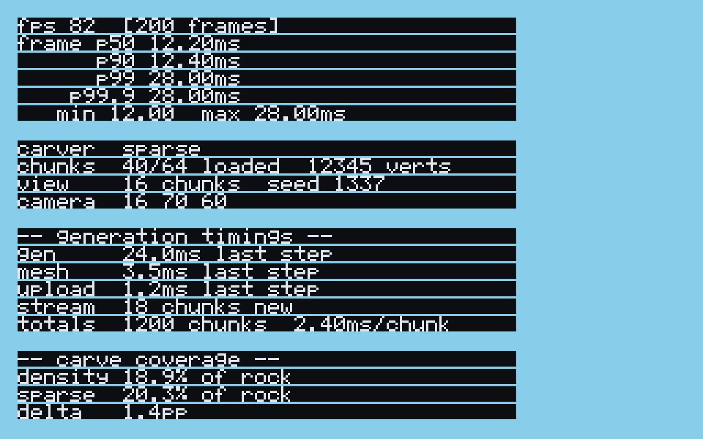
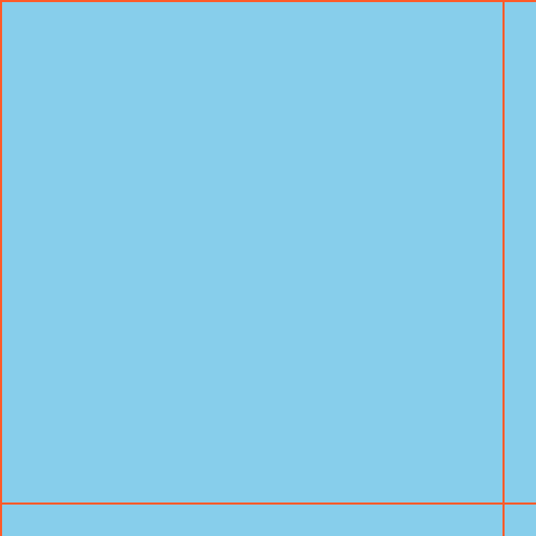

# voxel world-gen POC

A data-oriented voxel engine prototype in Rust that benchmarks two cave
generation paradigms on identical terrain:

1. **Full 3D density field** — continuous noise sampled per voxel, `O(N³)`.
2. **Sparse cave stamping** — deterministic origin lookup plus bounded SDF
   stamps, `O(S)`.

See [`PROJECT.md`](PROJECT.md) for the original architecture and
[`BENCHMARKS.md`](BENCHMARKS.md) for measured results.

## Status

| Stage | State |
| --- | --- |
| Config, layered dev/prod env | done, verified |
| Domain types (parse, don't validate) | done, 116 unit tests |
| Chunk storage + cull flags | done |
| Pass 1 heightmap | done |
| Pass 2A density carver | done, `O(N³)` confirmed by measurement |
| Pass 2B sparse carver | done, 2.7x faster per chunk at matched coverage |
| Debug views (ASCII, PPM/PGM, counters) | done, verified by eye |
| Greedy mesher + naive baseline | done, 256x fewer quads |
| Lighting (sunlight + block light) | done |
| Culling (frustum, flags, distance) | done |
| Debug HUD (fps, frame-time percentiles, live carver switch) | done, verified via software raster |
| wgpu + winit app | **compiles; not executed — see below** |
| Criterion benchmarks | done, results committed |

### Known limitation: the render path was never run

This machine's sandbox hides `/dev/dri`, so no GPU device is reachable and
`wgpu` hangs during adapter enumeration. That is environmental, not a code
defect: a minimal standalone wgpu program with none of this project's code
hangs the same way. The renderer compiles, and its shader, vertex layout,
winding order and camera matrices are all covered by tests that need no device,
but no frame has been observed. Run this on a machine with a real GPU:

```sh
cargo run -p voxel-app --bin voxel-app            # window
cargo run -p voxel-app --bin offscreen            # one frame to a PPM
```

The HUD cannot be seen here either, so it is verified a different way: a
software rasteriser test in `crates/voxel-app/src/hud.rs` composites the same
quads and pixels the GPU path builds and writes `debug-out/hud-overlay.ppm`.
That image caught two real defects the unit tests could not: every line was
carrying its own ragged background, and the key-hint line was clipped at the
window edge.

## Controls

| Key | Action |
| --- | --- |
| `W` `A` `S` `D` | Move |
| Arrows | Look (yaw / pitch) |
| `Space` / `Shift` | Rise / descend |
| `C` | **Switch carver** (`density` ↔ `sparse`) and regenerate in place |
| `M` | **Mesh view**: draw greedy quad outlines over the terrain |
| `B` | **Benchmark readout**: generation timings and carve coverage |
| `H` | Toggle the HUD |
| `R` | Reset the frame-time statistics |
| `Esc` | Quit |

Keyboard-only on purpose: pointer capture does not work over a remote session,
where verification actually happens.

### The debug HUD



Top-left overlay, drawn as text quads with a built-in 5x7 bitmap font:

- **`fps`** derived from the median frame time, not the mean. A single 200 ms
  hitch drags a mean down and makes a healthy run look broken.
- **`p50 / p90 / p99 / p99.9 / min / max`** from a rolling 600-frame window
  (ten seconds at 60 fps). This is the point of the HUD: the mean hides exactly
  the stutter that matters. In the image above, p50 is 12.2 ms while p99 is
  28 ms — the occasional long frame is visible in the tail and invisible in the
  median, which is how it feels to play.
- **`carver`**, `chunks drawn/total`, `verts`, view distance and seed.
- Camera position. Press `B` for the benchmark block described below.

### Flying, and how far you can see

The world streams around the camera at a **16-chunk render distance**, so it
extends in every direction and you can fly indefinitely. Chunks are generated
when the camera crosses a chunk boundary, meshed, and uploaded; a one-chunk step
generates exactly one column of new ground. Memory is bounded by evicting beyond
a halo four chunks wider than the view, so flying back and forth across the
boundary does not regenerate what you just left.

The world is unbounded horizontally but fixed vertically: an endless column
would generate chunks that are always empty above the terrain and always solid
below it.

### Benchmark mode (`B`)


Adds a block showing what the HUD otherwise could not:

- `gen` / `mesh` / `upload` — milliseconds for each stage of the last
  streaming step, so a stall can be attributed to a stage rather than guessed at.
- `stream` — chunks newly generated by that step.
- `totals` — chunks generated since startup and the cumulative ms per chunk.
- **carve coverage** — how much rock each approach removes, and the delta
  between them. Both are tuned to agree, because comparing two carvers is
  meaningless if one carves a fifth as much as the other.

### Mesh view (`M`)

Draws the outline of every greedy quad over the terrain. A flat surface shows
one large rectangle per merged region rather than a grid of individual faces,
which is the merge made visible rather than merely reported as a quad count.



Press `R` before a measurement so you are reading that moment rather than a
lifetime average, and `H` to get the overlay out of the way.

## Quick start

```sh
# Everything runs in dev by default; prod must be opted into.
cargo test --workspace
cargo run -p voxel-app --bin debug -- --world 4,4,4 --compare --slice 48
cargo run -p voxel-app --bin voxel-app

# Benchmarks: means, then the tail, then resources.
cargo bench -p voxel-core --bench carvers
cargo bench -p voxel-core --bench latency
cargo build --release -p voxel-app --bin carver_bench
perf stat -e instructions,cycles,branches,branch-misses ./target/release/carver_bench 8
```

## Environment

Configuration layers, lowest precedence first:

```
.env  →  .env.prod (when APP_ENV=prod)  →  .env.local  →  real environment
```

Dev is the default. Prod forces validation off so a release run cannot
accidentally benchmark with assertions enabled. Put machine-specific overrides
in `.env.local` (gitignored).

| Variable | Meaning |
| --- | --- |
| `APP_ENV` | `dev` (default) or `prod` |
| `VOXEL_WORLD_X/Y/Z` | World size in chunks |
| `VOXEL_WORLD_SEED` | Generation seed |
| `VOXEL_CARVER` | `density` (Pass 2A) or `sparse` (Pass 2B) |
| `VOXEL_CAVE_ORIGIN_DENSITY` | Cave origins per 1000 voxels³ |
| `VOXEL_CAVE_MIN/MAX_RADIUS` | Stamp radius range |
| `VOXEL_VALIDATION` | Extra debug assertions |
| `VOXEL_DEBUG_VIEWS` | Enable debug views |
| `VOXEL_FORCE_SOFTWARE_GPU` | `1` forces the CPU backend |
| `VOXEL_VSYNC` | `1` enables vsync |
| `RUST_LOG` | Log filter, e.g. `voxel_core=debug` |

## Reading the world without a GPU

The debug binary renders generation, geometry and lighting as text and images,
so correctness can be checked over SSH and in CI:

```sh
# Slice by eye, with carved air marked 'o'
cargo run -p voxel-app --bin debug -- --slice 40

# Both carvers on one world, with the work counters
cargo run -p voxel-app --bin debug -- --world 4,4,4 --compare

# Cross-sections for an image viewer
cargo run -p voxel-app --bin debug -- --slice 40 --images --out-debug debug-out
```

A correct cross-section reads as sky on top, grass (`"`), dirt (`:`), then
stone (`#`) below.

## Layout

```
crates/voxel-core    no GPU, no window: config, domain, world, terrain,
                     mesh, light, cull, debug
crates/voxel-app     wgpu + winit front end: camera, gpu, render, app,
                     plus the `debug` and `offscreen` binaries
```

## Design notes

Decisions where the code deliberately departs from a naive reading of
`PROJECT.md`, each with its reasoning in the module docs:

- **`VoxelIndex` gives `y` the highest bits** rather than following the doc's
  literal `x | (z << 4) | (y << 8)`. Same width, same bit ops, but every axis
  walk becomes unit or plane stride instead of `y` jumping 256 elements.
- **Chunk keys stay `i32` triplets**, not a packed `u64` hash. At 8 KiB per
  chunk the key size is noise next to the data it addresses, and readable
  coordinates are how placement bugs get found.
- **`ChunkPos::from_world` uses an arithmetic shift**, so world voxel -1 lands
  in chunk -1 instead of sharing chunk 0 with voxel 0.
- **Attribute-split voxel storage**, with the interleaved `u16` form confined to
  one boundary (`to_packed`) at GPU upload. Neither the mesher nor the light
  pass pays for the other's layout.
- **The naive mesher is kept** as an independent check on the greedy one. It
  caught a real bug: the naive version was letting air voxels emit faces, so
  every solid surface was reported twice.

## License

MIT — see [`LICENSE`](LICENSE).
